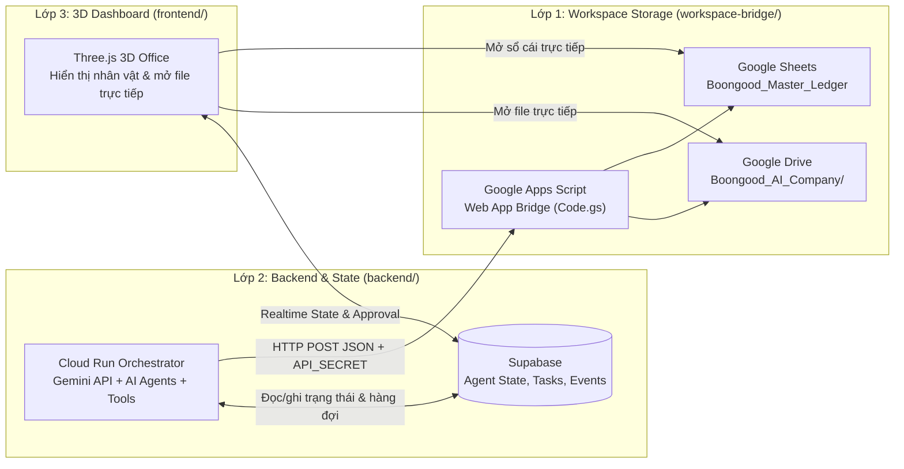
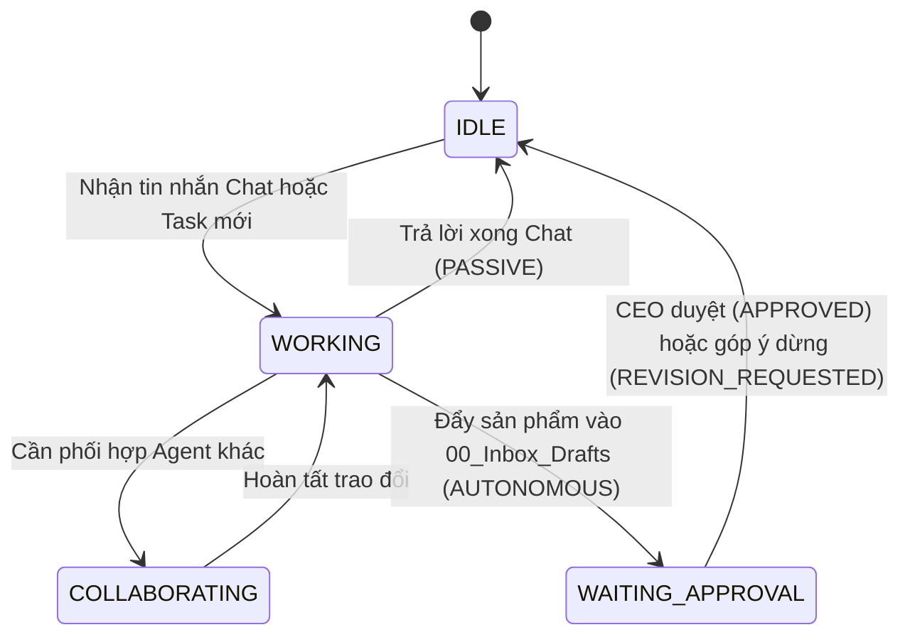

# Kiến trúc hệ thống Boongood AI Company

Tài liệu này là nguồn chuẩn (single source of truth) về kiến trúc 3 lớp, quy ước trạng thái nhân vật, cấu trúc Google Drive/Sheets và giao thức Workspace Bridge cho toàn bộ quá trình phát triển **Boongood AI Company**.

---

## 1. Kiến trúc 3 lớp tách biệt



| Lớp | Thành phần | Thư mục mã nguồn | Trách nhiệm chính |
| :--- | :--- | :--- | :--- |
| **Lớp 1 — Workspace Storage** | Google Drive, Google Sheets, Google Apps Script (`Code.gs`) | `workspace-bridge/` | Lưu trữ toàn bộ sản phẩm thật (báo cáo nghiên cứu thị trường, prototype/draft, bảng tính tài chính) và sổ cái trung tâm. Cung cấp HTTP JSON Bridge bảo vệ bằng `API_SECRET`. |
| **Lớp 2 — Backend & State** | Google Cloud Run (FastAPI), Gemini API, Supabase | `backend/` *(Giai đoạn 2)* | Vận hành theo mô hình **Chatbot-First**: mặc định `PASSIVE` (trả lời hỏi đáp & góp ý ảnh tối ưu token, 0 tool schema, nút lưu thủ công 0 token sang Drive) và tùy chọn bật `AUTONOMOUS` (tối đa 3 vòng suy luận, dừng chờ CEO duyệt). 0 token khi nhàn rỗi. |
| **Lớp 3 — 3D Dashboard** | Three.js Web App | `frontend/` *(Giai đoạn 3)* | Hiển thị văn phòng 3D theo trạng thái thực từ Supabase Realtime; cho phép CEO xem tiến độ, duyệt sản phẩm và mở trực tiếp link file trên Drive/Sheets. |

---

## 2. Quy ước trạng thái nhân vật & Đội hình 6 nhân vật Friends

Mọi nhân vật trong hệ thống (từ Backend ghi vào Supabase cho đến Frontend 3D render chuyển động) bắt buộc sử dụng đúng 4 mã trạng thái `current_state` và 2 chế độ vận hành `mode`:

### Chế độ vận hành (`mode` — Chatbot-First)
- **`PASSIVE` (Mặc định):** Chế độ Chatbot hỏi ý kiến / gửi ảnh góp ý (`POST /api/chat`). Chỉ nạp tối đa 8 tin nhắn gần nhất, không đính kèm tool schema nặng, hỗ trợ tùy chọn Google Search và nút lưu thủ công sang Drive/Sheets (`POST /api/chat/save-to-drive` — 0 token AI). Dùng biến `GEMINI_MODEL_PASSIVE`.
- **`AUTONOMOUS` (Tùy chọn mở rộng):** Bật riêng từng nhân vật qua `PATCH /api/agents/:id/mode`. Khi nhận việc (`POST /api/tasks`), giới hạn cứng tối đa **3 vòng suy luận**, gọi Workspace Bridge xuất bản nháp vào `00_Inbox_Drafts` và dừng ở `WAITING_APPROVAL` chờ CEO duyệt (`POST /api/tasks/:id/review`). Dùng biến `GEMINI_MODEL_AUTONOMOUS`.

### Đội hình 6 nhân vật Friends (bảng `agents` trong Supabase)

| `id` | Nhân vật | Vai trò chuyên môn |
| :--- | :--- | :--- |
| `rachel` | Rachel Green | Thương hiệu & Thiết kế (Brand, bao bì, thẩm mỹ hình ảnh) |
| `monica` | Monica Geller | Vận hành & Sản phẩm (Quy trình, chất lượng, kế hoạch triển khai) |
| `chandler` | Chandler Bing | Dữ liệu, Tài chính & Copywriting (Giá vốn, biên lợi nhuận, nội dung bán hàng) |
| `ross` | Ross Geller | Nghiên cứu & Pháp lý (Thị trường, đối thủ, quy định & nhãn mác) |
| `joey` | Joey Tribbiani | Truyền thông & Video (Kịch bản TikTok/Reels, hook thu hút, social media) |
| `phoebe` | Phoebe Buffay | Trải nghiệm Khách hàng & Ý tưởng Sáng tạo (CSKH, unboxing, ý tưởng độc đáo) |

### Quy ước trạng thái (`current_state`)

| Trạng thái | Ý nghĩa nghiệp vụ | Hành vi hiển thị trên 3D Dashboard |
| :--- | :--- | :--- |
| `IDLE` | Agent đang rảnh, chưa được giao nhiệm vụ mới. | Đứng/ngồi nghỉ tại bàn làm việc hoặc khu vực thư giãn; không có chỉ báo bận. |
| `WORKING` | Agent đang trả lời tư vấn, phân tích ảnh, tạo tài liệu hoặc tính toán. | Ngồi tập trung tại bàn làm việc (gõ máy tính), hiển thị nhiệm vụ đang xử lý. |
| `COLLABORATING` | Agent đang trao đổi, bàn giao dữ liệu hoặc phối hợp với Agent khác. | Di chuyển tới bàn đồng nghiệp hoặc khu họp nhóm để tương tác. |
| `WAITING_APPROVAL` | Agent đã tạo bản nháp trong `00_Inbox_Drafts` và dừng chờ CEO duyệt. | Di chuyển tới khu vực phòng CEO (hoặc giơ tín hiệu chờ duyệt), gắn link file Drive để CEO mở và duyệt/góp ý. |

### Luồng chuyển trạng thái chuẩn



---

## 3. Cấu trúc thư mục Google Drive & Google Sheets (Lớp 1)

Hàm `setupWorkspace()` trong `workspace-bridge/Code.gs` tự động khởi tạo cấu trúc sau và lưu toàn bộ ID vào `PropertiesService.getScriptProperties()`:

```text
Boongood_AI_Company/                 (ScriptProperty: ROOT_FOLDER_ID)
├── 00_Inbox_Drafts/                 (ScriptProperty: FOLDER_INBOX_ID)
│   └── [Nơi Agent lưu mọi bản nháp Docs/HTML/MD chờ CEO duyệt]
├── 01_Market_Research/              (ScriptProperty: FOLDER_MARKET_RESEARCH_ID)
│   └── [Nghiên cứu thị trường, phân tích đối thủ đã được CEO duyệt]
├── 02_Prototypes_Drafts/            (ScriptProperty: FOLDER_PROTOTYPES_ID)
│   └── [Bản mẫu HTML/Markdown/thiết kế sản phẩm đã được CEO duyệt]
├── 03_Data_Calculations/            (ScriptProperty: FOLDER_DATA_CALC_ID)
│   └── [Báo cáo số liệu, mô hình tính toán đã được CEO duyệt]
└── Boongood_Master_Ledger           (Google Sheets — ScriptProperty: MASTER_SHEET_ID)
```

### Schema 3 tab trong `Boongood_Master_Ledger`

1. **`Tasks_Log`** — Nhật ký nhiệm vụ & trạng thái phê duyệt:
   `Task_ID` | `Created_At` | `Agent_Name` | `Goal` | `Status` | `File_URL` | `Summary` | `CEO_Feedback`
2. **`Market_Data`** — Dữ liệu thị trường & đối thủ:
   `Date` | `Competitor_Name` | `Product` | `Price` | `USP` | `Source_URL` | `Notes`
3. **`Finance_Models`** — Bảng tính giá vốn & biên lợi nhuận:
   `Date` | `Item_Name` | `Cost_COGS` | `Selling_Price` | `Margin_Percent` | `Notes`

---

## 4. Hợp đồng giao tiếp Workspace Bridge (`doPost`)

Tất cả request từ Lớp 2 (hoặc script test) gửi tới Web App URL bằng phương thức `POST`, `Content-Type: application/json`, bắt buộc kèm `api_secret` khớp với `API_SECRET` trong `ScriptProperties`.

| `action` | Mục đích | Dữ liệu trả về chính |
| :--- | :--- | :--- |
| `create_doc` | Tạo Google Docs định dạng sạch trong `00_Inbox_Drafts` và ghi log vào `Tasks_Log`. | `task_id`, `file_id`, `file_url` |
| `append_sheet` | Ghi thêm 1 hoặc nhiều dòng vào tab `Market_Data` hoặc `Finance_Models`. | `sheet_name`, `rows_added`, `sheet_url` |
| `save_file` | Lưu file text / HTML / Markdown (prototype) vào `00_Inbox_Drafts` và ghi log vào `Tasks_Log`. | `task_id`, `file_id`, `file_url` |
| `approve_file` | Di chuyển file từ `00_Inbox_Drafts` sang `01_Market_Research`, `02_Prototypes_Drafts`, hoặc `03_Data_Calculations` và cập nhật `Status = APPROVED` trong `Tasks_Log`. | `file_id`, `file_url`, `target_folder`, `status` |

---

## 5. Lộ trình triển khai

- **Giai đoạn 1 (Hoàn thành):** Thiết lập cấu trúc dự án, tài liệu kiến trúc và hoàn thiện Lớp 1 (`workspace-bridge/`).
- **Giai đoạn 2 (Hoàn thành):** Xây dựng Lớp 2 (`backend/`) theo hướng Chatbot-First với FastAPI, Gemini API, Supabase (6 nhân vật Friends) và tích hợp Workspace Bridge, sẵn sàng deploy Cloud Run.
- **Giai đoạn 3:** Xây dựng Lớp 3 (`frontend/`) với Three.js kết nối Supabase Realtime và mở trực tiếp tài liệu trên Drive/Sheets.
